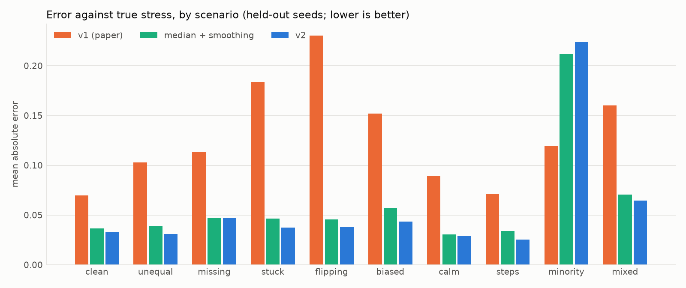
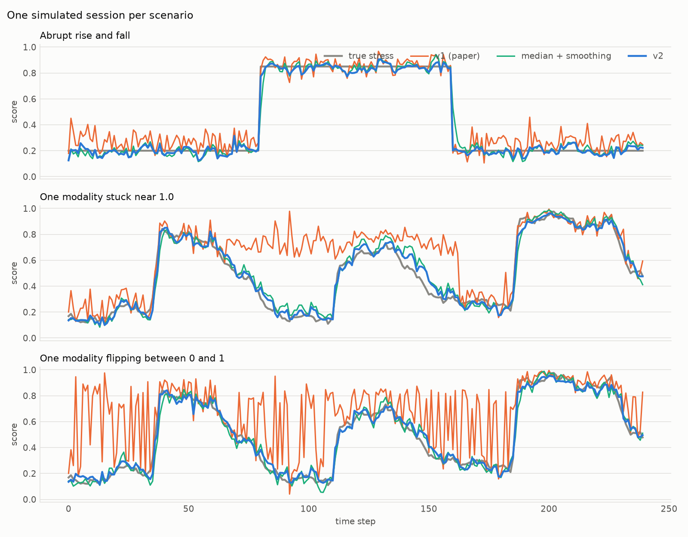

# The fusion method

Each of the four models outputs a stress score between 0 and 1. Fusion combines
the scores available at each moment into one fused score. This page describes the
original formula (`v1`), the redesign (`v2`), and how they compare.

All results numbers on this page are copied from
[`results/fusion_benchmark.md`](../results/fusion_benchmark.md), produced by
`scripts/run_fusion_benchmark.py`. The two small `v1` arithmetic examples below
are properties of the formula and are asserted in
[`tests/test_fusion_v1.py`](../tests/test_fusion_v1.py).

## The original formula (v1)

For each modality, `v1` keeps an exponential moving average (EMA) of its score,
then sets a weight from how far the new score is from that average (the residual)
and from the average itself (the persistence):

```
EMA        = lam * score + (1 - lam) * previous_EMA
residual   = score - EMA
persistence = EMA
weight     = max(0, alpha * residual + beta * persistence)
fused      = sum(normalised weight * score)
```

with `lam = 0.3`, `alpha = 0.7`, `beta = 0.3`. This is ported unchanged in
`src/safespace/fusion/v1.py` and reproduces the weights of the paper's Table 15.

It has three flaws, each kept on record as a test:

1. **A higher score earns a higher weight.** With the default settings a
   modality's weight works out to `max(0, 0.58 * score - 0.28 * previous_EMA)`,
   so a modality that reports stress is listened to more than one that reports
   calm. On the first step the fused score is exactly `sum(score^2) / sum(score)`.
2. **More stress can lower the fused score.** Scores (0, 0, 0, 0.9) fuse to
   0.90, but (0.1, 0.1, 0.1, 0.9) fuse to 0.70: three modalities reporting *more*
   stress pulls the result *down*, because they draw weight toward themselves.
3. **It can fail outright.** A modality whose score falls gets weight zero. If
   every score falls together, every weight is zero and the formula divides by
   zero. In the benchmark this happens often enough to need a guard: across the
   ten scenarios `v1` had an all-weights-zero step between 0.0 and 6.8 times per
   240-step session, and in the two scenarios with gaps it needed a missing
   score filled in on about 236 of 240 steps.

To run `v1` in the benchmark at all, missing scores are filled with the last
value and zero-weight steps fall back to the plain mean. Both substitutions are
counted and reported.

## The redesign (v2)

`v2` keeps the same two ideas, persistence and residual, but gives them a
different job: they decide how much to *trust* a modality, not how loud it is.
At each step, in order:

1. Use the scores present now. Also reuse a modality's last score for up to
   `carry` time units after it was seen, with weight fading linearly to 0.
2. If there is nothing to use, keep the previous fused score.
3. For each modality, from its history only, compute how far its level sits from
   the others, `offset = its EMA - median of the other modalities' EMAs`, and
   its trust, `trust = reliability * freshness / (floor^2 + variance of its
   residual + offset^2)`. A jumpy modality (large residual variance) or one that
   sits apart from the rest (large offset) is trusted less.
4. The weights are the trusts, normalised. The consensus is the weighted mean of
   the scores.
5. The fused score follows the consensus by `fused = fused + gain * (consensus -
   fused)`. The gain is small normally and climbs toward 1 when the consensus
   moves by far more than it usually does, so shared changes are followed at once
   while jitter is smoothed away.
6. Update each present modality's EMA and residual variance.

Feeding `v2` the mirrored scores `1 - score` gives `1 - fused`, so it has no
built-in tilt toward high or low. The tuned settings (seeds 0-99) are
`floor_std = 0.05`, `base_gain = 0.3`, `surprise_k = 2.5`, `var_rate = 0.05`,
`carry = 6.0`.

## Results

Tuned on seeds 0-99, measured on seeds 1000-1199 (200 sessions per scenario).
Mean absolute error against the true stress, lower is better:

| scenario | v1 | mean+ema | median+ema | v2 | oracle |
|---|---:|---:|---:|---:|---:|
| clean | 0.0698 | 0.0344 | 0.0365 | 0.0326 | 0.0343 |
| unequal | 0.1026 | 0.0454 | 0.0391 | 0.0309 | 0.0271 |
| missing | 0.1132 | 0.0462 | 0.0472 | 0.0473 | 0.0457 |
| stuck | 0.1838 | 0.0803 | 0.0465 | 0.0374 | 0.0801 |
| flipping | 0.2305 | 0.0913 | 0.0457 | 0.0383 | 0.0919 |
| biased | 0.1518 | 0.0738 | 0.0569 | 0.0436 | 0.0733 |
| calm | 0.0893 | 0.0283 | 0.0306 | 0.0293 | 0.0287 |
| steps | 0.0710 | 0.0305 | 0.0341 | 0.0254 | 0.0308 |
| minority | 0.1197 | 0.1789 | 0.2119 | 0.2239 | 0.1585 |
| mixed | 0.1602 | 0.0724 | 0.0704 | 0.0646 | 0.0628 |
| average | 0.1292 | 0.0681 | 0.0619 | 0.0573 | 0.0633 |

`oracle` is a Kalman filter told each modality's true noise level. It is a
reference for how well any method could do, not a competitor.

Over all scenarios, `v2` reads neither high nor low (bias -0.0127, against
+0.0966 for `v1`), raises almost no false alarms (0.0002 of calm steps, against
0.0791 for `v1`), and separates stress episodes well (AUC 0.9895). It reacts to
an abrupt rise and an abrupt fall equally fast (0.00 steps each), while `v1`'s
bias comes from its upward tilt.

The ablations confirm each part earns its place: removing the offset term more
than triples the error in `stuck` (0.0374 to 0.1371) and `biased` (0.0436 to
0.0845); a fixed gain slows the reaction (1.42 steps instead of 0.00).





## What v2 does worse

`v2` meets three of the four benchmark targets. It misses target 6: it does not
beat `v1` in *every* scenario. In `minority`, where only one modality detects the
stress and the other three miss it, `v1` scores 0.1197 and `v2` scores 0.2239.

This is the price of the redesign, not a bug. `v1` trusts the loudest modality,
so when only one modality is right and the rest are calm, `v1` follows the loud
one. `v2` trusts the agreeing majority, so it follows the three that miss. The
same instinct that makes `v2` ignore a stuck or flipping modality also makes it
ignore a lone correct one. Which is better depends on whether a disagreeing
modality is more often faulty or more often the only one that noticed; the
benchmark cannot settle that, so the trade-off is reported, not tuned away.

## Validation on real model outputs (virtual subjects)

The benchmark above uses simulated modality scores. The next step replaces them
with real, held-out scores from the four trained models, drawn to match a
simulated stress curve (`scripts/run_virtual_subjects.py`, seeds 1000-1199). The
pairing across people is artificial, but the model errors are real. See
`results/virtual_subjects.md`.

| method | MAE | bias | episode AUC | false-alarm share |
|---|---:|---:|---:|---:|
| v1 | 0.2301 | +0.1870 | 0.8874 | 0.1624 |
| mean+ema | 0.1257 | -0.0312 | 0.9922 | 0.0002 |
| median+ema | 0.1291 | -0.0342 | 0.9920 | 0.0002 |
| v2 | 0.1259 | -0.0266 | 0.9824 | 0.0019 |

Two honest conclusions:

- **v2 beats v1 decisively.** v1's MAE is almost double v2's, it reads far too
  high (bias +0.19 against -0.03), and it false-alarms on 16% of calm steps
  against 0.2%. v1's upward tilt is a real defect, not a simulator artefact.
- **v2 ties the best simple baseline here.** With all four modalities usually
  present and informative, a tuned smoothed mean matches v2 on error (0.126 each)
  and edges it on episode AUC (0.992 vs 0.982). v2's clear advantage appears only
  when a modality is stuck, flipping, biased, or the lone detector -- the fault
  scenarios of the benchmark above. So v2's case is robustness and zero bias, not
  that it is uniformly the most accurate combiner when every model is behaving.

## Limits

The simulator shows how a fusion rule behaves under stated assumptions about
noise, bias, gaps and faults. The virtual-subject step adds real model error but
still pairs modalities across different people. Neither shows that the fused score
matches one real person's stress; that needs several modalities recorded from the
same people (UBFC-Phys and StressID, Phase 4.2-4.3).
